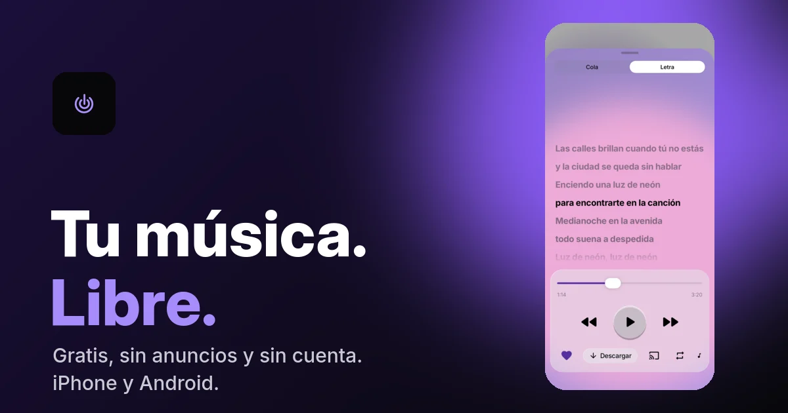
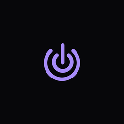
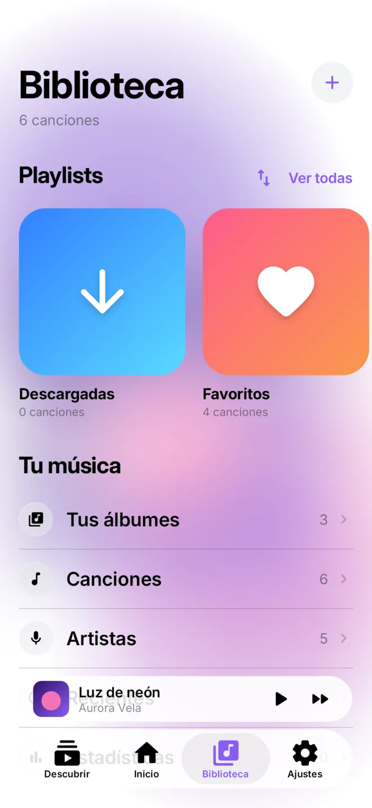
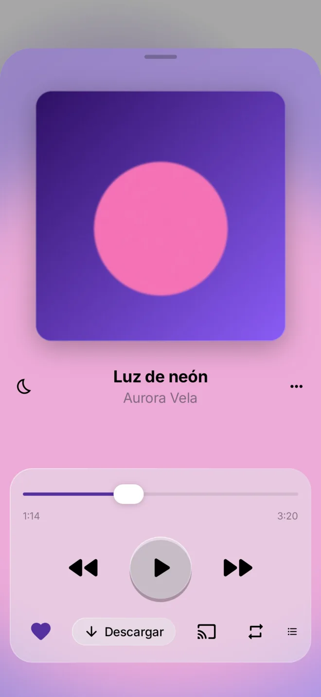
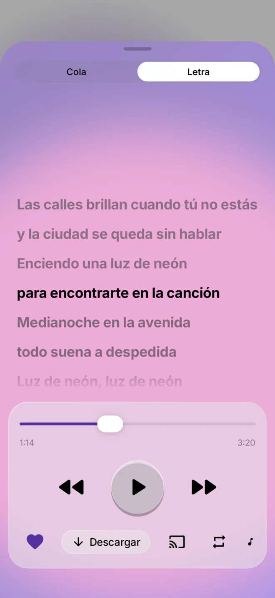
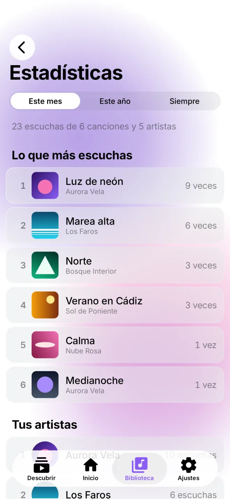
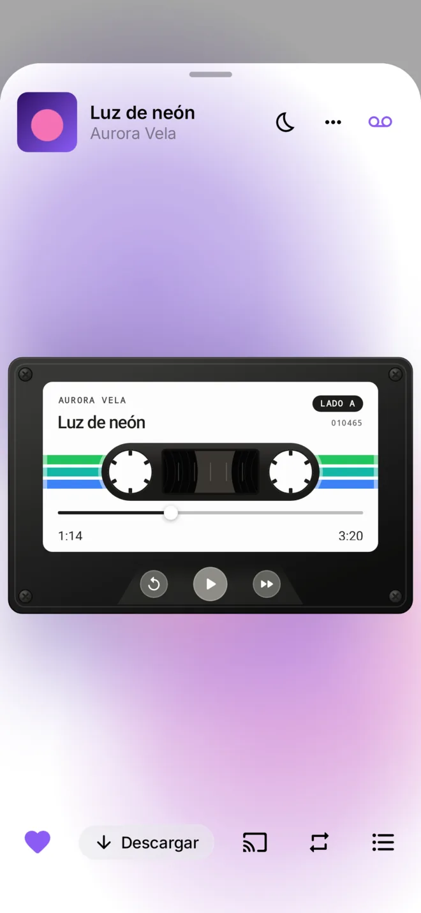
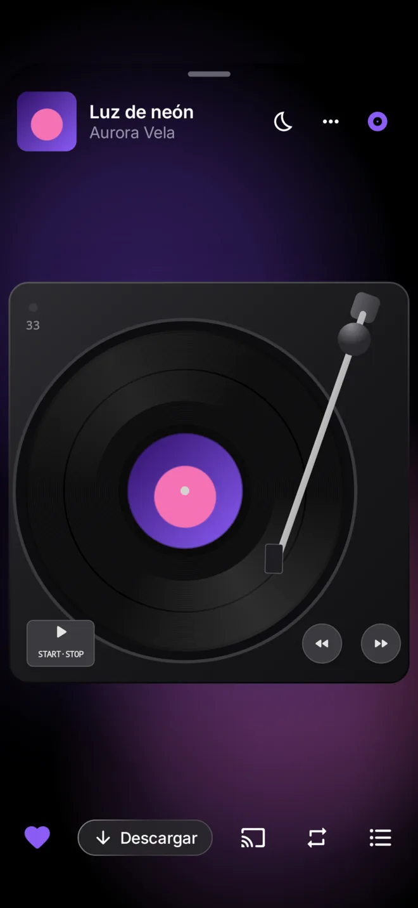
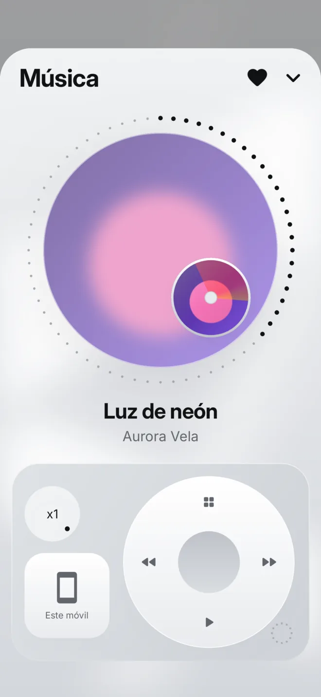
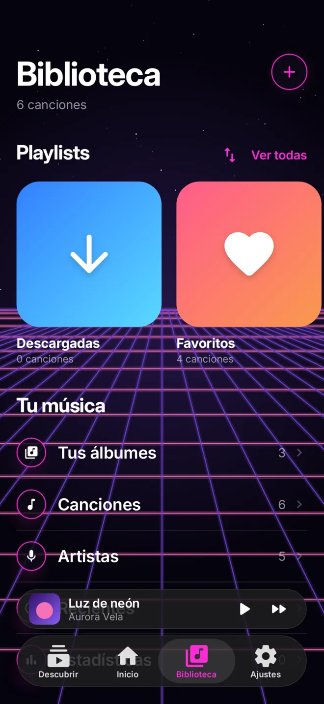

  
  <h1> Pear Music</h1>
  
Cliente de música libre, gratis y sin anuncios para <b>iPhone</b> y <b>Android</b>. 
  Todo el catálogo de YouTube Music, con descargas, letras, Jam entre móviles y reproductores con personalidad.

  
  
  

  <h3>Descargar</h3>
  
  
  
   Fuente de AltStore/SideStore: <code>https://libremusic-landing.8toxbox8-69a.workers.dev/altstore.json</code>

## Qué hace

- Escucha cualquier canción de YouTube Music **gratis, sin anuncios y con la pantalla apagada**.
- **Descargas** a la máxima calidad para escuchar sin conexión.
- **Letras sincronizadas** (LRCLIB), también sin conexión.
- **Jam**: una playlist entre varias personas que están juntas, entre iPhone y Android, con un QR.
- **Reproductores con personalidad**: normal, casete (gira las bobinas), vinilo (scratch) y Air.
- **Temas** Cristal, Aire, Neón y Sistema, y colores que salen de la portada.
- **Discografía completa** de cada artista (YouTube Music + MusicBrainz) y álbumes y playlists fijados.
- **Importa** de Apple Music, Spotify (enlace o CSV de Exportify) y SimpMusic.
- **Widgets** en Android, estadísticas, temporizador para dormir, fundido entre canciones y radio infinita.
- En **7 idiomas**: español, català, valencià, galego, euskara, English y Esperanto.
- **Sin cuenta obligatoria**: la cuenta es opcional y tu biblioteca va cifrada con una clave que sólo tienes tú.

## Capturas

  
  
  
  

  
  
  
  

## Instalar

- **Android**: descarga el APK de [Releases](https://github.com/ToxBox8/pear-music/releases) o de la
  [web](https://libremusic-landing.8toxbox8-69a.workers.dev/instalar/android). También con Obtainium.
- **iPhone**: con AltStore o SideStore, añade la fuente `altstore.json` (arriba) o instala el `.ipa` de Releases con
  Sideloadly. Paso a paso en la [web](https://libremusic-landing.8toxbox8-69a.workers.dev/instalar/iphone).

## Créditos

- **[SimpMusic](https://github.com/maxrave-dev/SimpMusic)**, de maxrave-dev (GPL-3.0): la barra inferior de cristal
  estilo SimpMusic de Android está adaptada de su código, y es una referencia constante.
- **[AndroidLiquidGlass](https://github.com/Kyant0/AndroidLiquidGlass)**, de Kyant (Apache-2.0): gestos y animación
  de la gota.
- **[The Kitchen](https://www.dqnamo.com/kitchen)**, de dqnamo: inspiración de los componentes y del casete.
- **Air OS**, de Geex Arts: inspiración del reproductor Air.
- **[Inter](https://rsms.me/inter/)**, de Rasmus Andersson (OFL); **[LRCLIB](https://lrclib.net)** (letras);
  **[MusicBrainz](https://musicbrainz.org)** (discografías).

## Aviso legal

Pear Music es un proyecto personal, gratuito y sin ánimo de lucro. **No está afiliado, patrocinado ni aprobado por
Google LLC, YouTube ni YouTube Music**; esos nombres son marcas de sus dueños y se usan sólo para decir con qué
catálogo es compatible. La app usa una interfaz no oficial que puede dejar de funcionar en cualquier momento.

Cada persona es responsable de cómo la usa y de respetar las condiciones de los servicios a los que accede y los
derechos de autor de la música. Las descargas son para escuchar sin conexión dentro de la app, no para redistribuir.

## Privacidad

Sin anuncios ni rastreo. La biblioteca, las estadísticas y las descargas se quedan en el móvil. La telemetría de
rendimiento y la cuenta son opcionales, están apagadas por defecto y se pueden borrar desde la app. Detalles en la
[política de privacidad](https://libremusic-landing.8toxbox8-69a.workers.dev/privacidad).

## Código

Monorepo con las dos apps nativas: `apps/ios` (SwiftUI) y `apps/android` (Kotlin + Jetpack Compose + Media3), y los
Workers de Cloudflare en `services/`. Para contribuir, empieza por `AGENTS.md`, `CONTEXT.md` y `DECISIONS.md`.

## Licencia

[GPL-3.0](LICENSE). Puedes usar, estudiar, modificar y compartir el código; las versiones modificadas que
distribuyas tienen que seguir siendo GPL-3.0 y con su código disponible.

Antes se llamaba LibreMusic.
